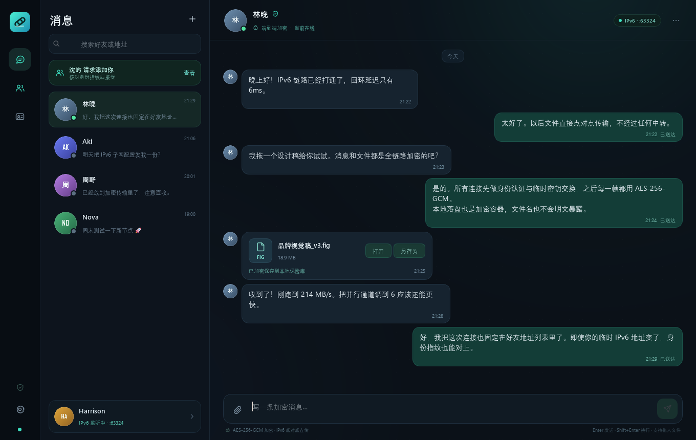

# V6Link

[English](README.en.md) | 简体中文

[](https://github.com/HarryXiaoCN/V6Link/actions/workflows/ci.yml)
[](LICENSE)
[](https://www.python.org/)


**基于 IPv6 的点对点加密通讯工具。** 不经过中心服务器，消息和文件直接在两个设备之间传输。



V6Link 使用 Python + asyncio 实现网络层，PySide6 实现桌面界面。好友的 IPv6 地址可以保存多个；连接时按最近成功地址依次尝试，并由固定的加密身份指纹保证「地址变了，还是同一个人」。

---

## 功能

- **好友列表 + 多 IPv6 地址**
  - 每个好友可保存多个 `IPv6:端口` 地址。
  - 自动记录连接成功时间，优先使用最近可用的地址。
  - 认证成功后自动学习 TCP 源地址，并解析对方在加密问候中广播的当前 IPv6 地址；地址变化后联系人会立即刷新，无需重新添加好友。
  - 对方身份由 Ed25519 公钥指纹固定，地址变化无法冒名顶替。
- **本地 IPv6 监听**
  - 监听 `::` 上的 TCP 端口（默认 `4455`），接收好友的加密会话。
  - 端口可在设置中热切换，无需重启应用。
- **托盘常驻**
  - 点击最小化后窗口收进系统托盘，后台继续监听和接收消息。
  - 双击托盘图标恢复窗口；托盘菜单可以显示主窗口或退出。
  - 窗口隐藏时，新消息与好友请求会弹出系统通知，托盘提示显示未读数量。
- **文本与文件**
  - 文本消息带送达确认、失败重试和好友请求状态。
  - 文件支持多选、直接拖入窗口、进度与速度显示；接收完成后自动保存到可配置的下载目录，发送方和接收方都能直接打开所在文件夹。
  - **接收确认**：对方确认后才会创建本地加密文件并开始传输。
  - **取消与暂停**：「取消」会删除已传输分片且不能续传；网络中断、客户端重启会自动转为暂停，保留分片，恢复后可从已确认的分块位图继续。
  - 并行加密传输：默认 4 条独立加密数据通道，可调 1–8 条；文件分块直传，不做逐块等待确认，受 TCP 背压控制。
- **全部应用数据加密**
  - 传输：Ed25519 身份认证 + 每次连接新的 X25519 临时密钥交换 + HKDF-SHA256 + AES-256-GCM。
  - 本地：好友、消息、地址、身份私钥、文件密钥均放在 AES-256-GCM 加密保险库中；Windows 下主密钥由 DPAPI 绑定当前用户保护。
  - 接收过程按独立随机密钥写入加密容器；完成后自动在下载目录生成一份明文副本供直接使用，保险库中保留加密副本。
- **好友间版本更新**
  - 版本较新的一方可以在好友菜单里把**自己正在运行的程序本体**推送给版本更旧的已认证好友。
  - 更新包走现有的端到端加密直连通道，并用发送者的 Ed25519 身份密钥签名；接收方下载完成后再次校验签名与 SHA-256 才会落盘。
  - 接收方需要两次明确确认（接收邀请、重启安装）；Windows 单文件 exe 会自动备份旧版本、替换新版本并重新启动。
- **方便美观的深色界面**
  - 拖拽遮罩、消息气泡、文件卡片、好友请求卡片、安全设置、加密名片。
  - 支持粘贴好友加密名片自动填写昵称、身份指纹和地址。

详细威胁模型与密码学说明见 [SECURITY.md](SECURITY.md)。

---

## 环境要求

- Windows 10/11（主要目标平台；Linux/macOS 可运行，但没有 DPAPI，主密钥文件会使用 `0600` 权限保护）
- Python **3.11+**
- 双方具备可互达的 IPv6 地址。公网直连通常需要允许入站 TCP，建议在 Windows 防火墙中放行所选端口。
- 两端都需要能访问 IPv6；纯 IPv4 网络无法使用。

### Windows 防火墙

以管理员身份打开 PowerShell，放行默认端口（如果修改了监听端口，请同步修改）：

```powershell
New-NetFirewallRule -DisplayName "V6Link TCP 4455" -Direction Inbound -Protocol TCP -LocalPort 4455 -Action Allow
```

检查本机是否有 IPv6：

```powershell
ipconfig
ping -6 ::1
```

---

## 安装与运行

### 方式一：双击启动（Windows）

首次双击 `run.bat` 会自动创建 `.venv` 并安装依赖，之后再次双击直接启动。

### 方式二：手动运行

```powershell
py -3 -m venv .venv
.\.venv\Scripts\python.exe -m pip install -r requirements.txt
.\.venv\Scripts\python.exe main.py
```

调试时建议用 `python.exe` 而不是 `pythonw.exe`，这样可以看到异常输出。

### 方式三：单文件 exe（分享给没有 Python 的人）

本仓库的 `dist\V6Link.exe` 是用 PyInstaller 打好的 64 位 Windows 单文件程序（**v0.3.0**，约 51 MB）。发送这一个文件即可，对方不需要安装 Python 或依赖。两端必须使用同一新版协议。

- 双击运行；首次启动会先解压内置运行库，可能需要几秒钟。
- 程序本体不读写 exe 所在目录，好友和消息仍保存在 `%LOCALAPPDATA%\V6Link`。
- 这是未签名的自编译程序，Windows SmartScreen 可能提示「Windows 已保护你的电脑」；确认来源后可点「更多信息 → 仍要运行」。
- Windows 防火墙仍需按上面的规则放行 TCP 端口（默认 `4455`）。
- 不要连同数据目录一起分享，里面包含本机加密身份和聊天数据。

重新打包的方法见 [打包 Windows exe](#打包-windows-exe)。

如果在其他平台：

```bash
python3 -m venv .venv
source .venv/bin/activate
pip install -r requirements.txt
python main.py
```

也可以通过包安装（可选）：

```powershell
.\.venv\Scripts\python.exe -m pip install -e .
v6link
```

---

## 本机双实例快速验证

在同一个 Windows 桌面上可以开两个独立数据目录的实例，验证发现、好友请求、加密消息和文件传输：

```powershell
# 终端 1
.\.venv\Scripts\python.exe main.py --data-dir .\demo-alice --port 4455

# 终端 2
.\.venv\Scripts\python.exe main.py --data-dir .\demo-bob --port 4456
```

在 Alice 里通过「我的加密名片」复制名片，在 Bob 中点击「+」→「粘贴名片」；再把 Bob 的名片粘贴给 Alice。也可以手动添加：

- Alice 添加 Bob 的地址：`::1`，端口 `4456`
- Bob 添加 Alice 的地址：`::1`，端口 `4455`

首次发送消息会发起好友请求，在另一侧接受后即可互相收发。回环测试无需在防火墙放行端口。

---

## 使用

### 1. 交换加密名片

点击左下角的「我」或左侧导航中的名片图标，打开 **我的加密名片**：

- 复制完整名片，发给好友；
- 名片包含昵称、身份指纹、可跨设备使用的**全局 IPv6 地址**和监听端口；`::1` 回环地址与 `fe80::` 链路本地地址不会写入名片。
- 指纹是公钥指纹，不包含私钥，可以安全分享。

> 名片会在本机生成地址列表。跨设备使用时，最终以实际可连通的端口和地址为准。

### 2. 添加好友

点击左侧「消息」右上角的 **+**，打开添加好友窗口：

- 可以手动填写昵称、可选的身份指纹和 IPv6 地址；
- 也可以让好友先把加密名片复制到剪贴板，再点击 **粘贴名片** 自动填入；
- 地址既支持 `240e:abcd::1`，也支持 `[240e:abcd::1]:4455` / `[fe80::1%以太网]:4455`。

首次连接采用 **TOFU（首次使用即信任）**：如果添加时没有填写身份指纹，第一次握手后会固定实际指纹。之后如果指纹变化，连接会被阻止，并在界面中提示安全告警。

### 3. 第一次发消息与好友请求

添加好友后发送第一条消息，会：

1. 向对方发起加密好友请求；
2. 对方在好友请求列表中核对指纹并接受；
3. 接受方会向请求方发出加密的「已接受」通知；
4. 请求方自动重试之前等待中的消息。

如果对方没有及时接受，界面会显示等待状态，并允许手动重试。

### 4. 发送文件

- 点击输入框左侧的回形针选择文件；
- 或直接把一个/多个文件拖入聊天区域；
- 接收方会收到逐文件确认弹窗；确认后才创建加密容器并开始传输，拒绝则不产生文件；
- 传输中双方都可以点「取消」。取消意味着不要这个文件：接收端会删除未完成分片，双方都不能再从该分片续传；
- 网络波动、对端离线或应用关闭会自动进入「暂停」，不会删除分片。发送方点「继续」时，接收方会校验同一文件指纹与已收分块位图，只传输缺失部分；
- 暂停状态在应用重启后仍保留；接收方如果已经接受过该文件，匹配的续传会自动恢复，不重复弹确认；
- 接收完成后自动解密保存到设置中的下载目录（默认系统下载目录），不需要再手动另存为；
- 「打开」直接打开下载目录中的本地文件；「所在文件夹」直接打开保存位置；「另存为」仅用于另存一份到其他位置；
- 发送方的文件卡片在「打开」旁也有「所在文件夹」，用于定位原始文件；
- 发送方保留原文件路径，源文件被移动、删除或内容改变后不能继续暂停中的传输，需要重新发送。

### 5. 设置

- **昵称**：下一个加密握手中会告知好友。
- **监听端口**：立即重启 IPv6 监听，不重启应用。端口冲突会给出错误并恢复原监听。
- **并行通道**：1–8 条，数值越高越适合高延迟/大文件链路，局域网可适当降低。默认 4。
- **下载目录**：接收完成的文件自动保存的位置，默认 `~/Downloads`；可选择任意有写权限的文件夹。

### 6. 最小化到托盘

- 点击窗口的最小化按钮，V6Link 会隐藏到系统托盘并继续监听 IPv6 连接、接收消息；好友此时仍能主动联系你。
- 双击托盘图标，或右键 → **显示主窗口**，可以恢复窗口；最小化前的最大化状态会被保留。
- 窗口隐藏时，新消息和好友请求会以系统通知提示；托盘图标的提示文字会显示未读消息数量。
- 右键托盘图标 → **退出 V6Link** 才会真正退出。直接关闭主窗口（×）与以前一样会退出程序。
- 如果当前桌面没有可用的系统托盘（例如部分精简系统或远程会话），最小化会保持普通的窗口最小化行为。

### 7. 好友互推版本更新

版本较新的一方可以把本机程序直接推给版本更旧的已认证好友，不需要对方自己去找安装包。

**推送方（版本较新）**

1. 在左侧好友列表右键，选择 **推送版本更新…**；
2. 确认后 V6Link 会读取本机程序（单文件 exe，或源码运行时的源码包）、计算 SHA-256、用身份私钥签名，然后通过加密通道把邀请发给对方；
3. 如果对方版本不比本机旧，会直接提示不需要更新；
4. 对方接受后，数据由对方按需拉取，聊天窗口不受影响。

**接收方（版本较旧）**

1. 收到「×× 想推送新版本」弹窗，其中显示版本、体积、SHA-256 摘要和对方给出的说明；
2. 点 **接收并更新** 后开始下载，弹窗显示进度与速度；点 **取消接收** 会删除已下载的部分；
3. 下载完成后再次校验 SHA-256 与签名，同时界面给出 **立即重启并更新**；
4. 确认重启后，V6Link 会生成一个只做替换的 PowerShell 脚本，等当前进程退出后把旧 exe 备份为 `V6Link.exe.old-<旧版本>`，写入新 exe 并重新启动；替换失败会自动回滚。

**安全边界**

- 只有已经完成身份认证的好友才能推送；签名用对方固定的 Ed25519 公钥校验，内容被改动会直接拒绝；
- 接收只是下载和校验，不会自动执行；安装必须由你在第二个确认框里主动触发；
- 不校验「官方发布者」，更新可信度等于你对该好友的信任；不接受来源不明的第三方转发文件。

> 源码方式运行时（`python main.py`）没有可替换的 exe：接收方只会把更新包保存到 `<数据目录>\updates\pending\`，界面会显示完整路径，由你自行处理。自动替换与重启目前只在 Windows 单文件 exe 上提供。

---

## 加密设计摘要

### 传输

- 每个安装生成一对长期 Ed25519 身份密钥。好友身份指纹 = `SHA-256(公钥)`，固定并展示给用户。
- 每条 TCP 连接都执行新的握手：
  - 客户端发送带签名的 Client Hello；
  - 服务端返回带签名的 Server Hello，绑定双方临时公钥和随机数；
  - 双方用 X25519 计算共享密钥，通过 HKDF-SHA256 派生双向会话密钥；
  - 客户端随后发送第一条 AES-256-GCM 加密帧，完成持有私钥的证明。
- 所有应用数据（文本、文件块、控制指令）都是 AES-256-GCM 加密帧，使用每条连接独立的双向密钥和单调递增 nonce，AAD 绑定完整握手 transcript。

### 版本更新

- 更新邀请（`update_offer`）包含版本、体积、SHA-256、文件名和说明，并用发送方的长期 Ed25519 身份私钥对
  `offer_id / version / size / sha256 / kind / filename / notes` 的定长编码签名。
- 接收方用联系人已固定的公钥验证签名，只在签名有效时才展示邀请；下载完成后还会重新计算 SHA-256 并再次验签。
- 只有通过校验的字节才会从 `updates/incoming/*.part` 原子移动到 `updates/pending/`；安装前再校验一次体积、SHA-256 和 PE 头（`MZ`）。
- 更新包不经过任何服务器，也没有「官方更新源」；可信度来自发送方的身份指纹。

### 本地

- 状态数据保存在单个 AES-256-GCM 加密的保险库 `vault.v6` 中，使用原子替换写入。
- Windows 下随机主密钥由 DPAPI（当前用户范围）加密后存于 `vault.key`，不会留下裸主密钥。
- 数据目录默认：`%LOCALAPPDATA%\V6Link`。
- 收到的文件使用独立的随机 256 位密钥，按固定大小分块写入加密容器；文件内容按 AES-GCM 分块认证。
- 文件名、大小、文件密钥、联系人、消息等元数据均在加密保险库中。

### 加密边界

以下内容不属于「应用数据加密」的覆盖范围，请务必了解：

- **网络元数据**：双方 IP 地址、端口、流量大小和时序对网络观察者/运营商可见。V6Link 不提供匿名网络或混淆流量。
- **发送方的原文件**：拖入发送的文件不会被复制进保险库，它原本就存在于你的磁盘；V6Link 只加密传输过程。
- **下载目录中的明文文件**：接收完成后会自动在下载目录生成明文副本；它不再受 V6Link 保险库加密保护，退出应用也不会删除。
- **打开/导出文件**：若尚未自动保存，点击「打开」会临时解密到系统临时目录；「另存为」会在你选择的位置写出明文副本。
- **剪贴板**：复制名片、指纹或消息时会进入系统剪贴板；粘贴/截屏/屏幕录制不受 V6Link 控制。
- **系统通知**：最小化到托盘时，新消息与好友请求会通过系统通知中心显示好友名和预览，内容可能保留在通知历史中，或显示在锁屏、投屏与录屏画面上。
- **操作系统**：DPAPI 绑定当前 Windows 用户，同一登录用户的进程、已解锁的会话、恶意软件或内存抓取仍可能读取解密后的数据。V6Link 不防御已经被攻陷的系统。
- **无密码保护模式**：当前版本不需要额外输入密码，解锁依赖 Windows 用户凭据。若你需要「关机后仍需密码」的保管库，请等待后续版本或使用全盘加密。

> 当前协议为自研实现，尚未经过第三方密码学审计。请把它当作一个透明的工程实现，而不是经过认证的安全产品。

---

## 传输性能

为了贴近「最大化速度」的目标，传输路径刻意避免常见瓶颈：

- 二进制 raw 帧，不做 Base64，不做压缩。
- 每个连接 1 MiB 分块，异步 `drain()` 背压，不做逐块 ACK。
- 默认 4 条独立 TCP + 加密数据连接同时拉取文件块。
- 接受端直接按 offset 写入加密容器，不会先落明文再加密，也不在传输过程中做二次重写。
- AES-256-GCM 每帧认证；接收完成后校验分块数量、分块长度和文件总大小。

本机 IPv6 回环、Windows 11、4 条通道的简单测试中，64 MiB 加密文件（传输加密 + 本地加密写入）约 0.6 秒级。实际速度由 IPv6 链路、磁盘、CPU 和防火墙决定。可在设置中调整并行通道数。

---

## 项目结构

```
v6link/
  crypto.py       Ed25519 身份、X25519 握手、AES-GCM 加密帧
  keyvault.py     DPAPI / 权限保护的主密钥
  vault.py        AES-256-GCM 加密本地状态
  filestore.py    随机访问的加密附件容器
  netutil.py      IPv6 解析、地址发现、文件名安全
  sharecard.py    名片解析（无 Qt 依赖）
  updates.py      版本比较、更新包签名/校验、暂存与 PowerShell 原地安装
  engine/         网络引擎（facade + 服务）
    core.py       ChatEngine facade、生命周期、跨服务编排
    connections.py / contacts.py / messaging.py / updates.py
    files/        文件传输：inbound / outbound / exports / service
    router.py     入站命令分发
    events.py / tasks.py / transport.py / models.py
  runtime.py      后台 asyncio 线程与线程安全 API
  ui/
    app.py        应用入口、单实例锁
    bridge.py     后端线程 → Qt 主线程的排队事件桥
    theme.py      调色板与 QSS
    icons.py      运行期矢量图标/头像
    widgets.py    好友列表、消息气泡、拖拽、输入区
    dialogs.py    添加好友、设置、加密名片、好友请求
    tray.py       系统托盘、桌面通知与退出
    main_window.py 主窗口
requirements.txt  运行依赖
requirements-build.txt  打包依赖（PyInstaller）
tests/            加密、存储、IPv6 端到端测试
assets/           Windows exe 图标
packaging/        版本信息与打包脚本
V6Link.spec       PyInstaller 单文件构建配置
main.py           本仓库启动入口
run.bat           Windows 一键启动（纯 ASCII）
dist/V6Link.exe   打包产物（构建后生成，可直接分享）
```

---

## 打包 Windows exe

产物是单文件 `dist\V6Link.exe`，不弹出控制台窗口。

首次构建时安装打包工具：

```powershell
.\.venv\Scripts\python.exe -m pip install -r requirements-build.txt
```

然后运行：

```powershell
powershell -ExecutionPolicy Bypass -File .\packaging\build_exe.ps1
```

或者等价地直接调用 PyInstaller：

```powershell
.\.venv\Scripts\python.exe -m PyInstaller --noconfirm --clean V6Link.spec
```

构建配置：

- [V6Link.spec](V6Link.spec)：onefile、无控制台、图标、版本信息及未使用 Qt 模块排除。
- [assets/V6Link.ico](assets/V6Link.ico)：Windows 图标（16–256 px）。
- [packaging/version_info.txt](packaging/version_info.txt)：exe 文件版本信息。
- [packaging/build_exe.ps1](packaging/build_exe.ps1)：构建脚本。

产物未签名；正式对外分发时建议使用代码签名证书，减少 SmartScreen 和杀毒软件的误报。

排查单文件运行路径（例如确认「好友推送更新」会替换哪个文件）时，可以运行：

```powershell
.\dist\V6Link.exe --diagnose
```

它会输出 `sys.executable`、`_MEIPASS` 和 `persisted_executable`（实际会被替换的程序），同时写入 `%TEMP%\v6link-diagnose.json`。

---

## 测试

当前测试覆盖：

- 握手、身份指纹固定、错误指纹拒绝；
- 抓包字节中不出现消息明文；
- 本地保险库与附件容器的加密、防篡改；
- 好友请求、消息双向收发；
- 文件接收确认、拒绝后不落盘；
- 接收完成自动保存到可配置的下载目录，并记录保存路径；
- 下载目录设置持久化并跨重启生效；
- 导出后文件卡片可打开所在文件夹；
- 对方 IPv6 源地址变化及问候中广播的新地址会被自动学习；
- 传输中双方取消并删除未完成分片；
- 网络/客户端重启暂停后按分块位图续传，最终内容一致；
- 并行双向文件传输与解密一致性；
- 版本号比较、更新包签名绑定身份、篡改/异常字段拒绝；
- 好友间完整更新流程：推送邀请、接收落盘并校验、拒绝通知、接收方版本不旧时拒绝推送、下载中途取消清理分片。

运行：

```powershell
$env:PYTHONPATH = "."
.\.venv\Scripts\python.exe -m unittest discover -s tests -v
```

无 IPv6 回环的环境（例如 GitHub 托管 runner）会自动跳过 IPv6 端到端用例；也可以设置 `V6LINK_SKIP_E2E=1` 显式跳过。

---

## 连接排查

### 提示“对方身份指纹不一致”

V6Link 会固定好友的 Ed25519 身份指纹。该提示表示当前连接到的服务出示的公钥，与好友记录中保存的指纹不同。常见原因是对方重装/清空过数据、换了 Windows 用户或电脑，或者地址已经指向了另一台 V6Link。

> **0.3.0 起支持好友互推版本更新**：新版一方可通过加密直连把程序本体推给旧版好友，对方确认、校验后自动替换并重启；0.2.2 起，接收完成自动保存到可配置下载目录，并从加密问候中学习对方最新 IPv6 地址；0.2.1 起文件卡片支持打开本地所在文件夹；0.2.0 起，文件传输需要接收确认，并支持取消/暂停/续传；0.1.2 起名片只包含全局/可路由 IPv6 地址，不再包含 `::1` 回环地址和 `fe80::` 链路本地地址；导入旧名片时也会忽略这两类地址。0.1.1 已修复本机自连被误报为身份变化的问题。

如果确实是身份变化，当前替代做法是双方核对新指纹后重新交换名片；旧版本需要删除并重新添加联系人。升级到 0.3.0 后，建议让对方重新生成名片。

### 对方 IP 变化后回复失败

V6Link 没有中心服务器或地址目录。只有对方主动向本机发起新连接（消息、文件或好友请求）时，本机才能从这次加密连接中学习到新地址；现在会同时记录 TCP 源地址和对方加密问候中广播的当前 IPv6 地址，并立即刷新联系人。

如果对方换了网络但还没有联系过本机，本机不可能凭空知道新地址，需要对方先发一条消息、一份新名片，或确认其新网络允许入站 TCP。收到连接后仍无法回复时，优先检查对方新网络的防火墙/端口，而不是继续等待自动发现。

### 两台电脑仍然连不上

身份问题解决后，如果消息显示无法连接，请检查真正的网络可达性：

1. 两台电脑都必须有可互达的 IPv6 地址。可分别执行 `ipconfig`，确认存在非 `fe80::` 开头的全局 IPv6 地址（240e、2409、2001 等）。
2. 在另一台电脑上尝试 `ping -6 对方的全局IPv6地址`。
3. 在**接收连接的电脑**上放行入站 TCP 端口（默认 4455）；两台电脑都要能接受对方连接时都要放行。
4. 仅在 IPv4 网络、或路由器/防火墙禁止 IPv6 入站时，V6Link 无法直连。它没有中继服务器，也不做 NAT 穿透。
5. 名片不会包含 `fe80::` 链路本地地址：它只适用于同一链路，且接口范围来自发送端本机，复制到另一台机器通常不可用。仅为同一链路调试时，可在添加好友时手动填写带有正确本机接口范围的 fe80 地址。

---

## 已知限制

- 需要双方 IPv6 可互达，不做 NAT 穿透、中继或离线消息。
- 首次信任无带外指纹验证时可能受到中间人攻击；请通过其他渠道核对指纹。
- 没有群聊、语音/视频、消息编辑/撤回。
- 文件续传需要同一个 `transfer_id` 和相同的 SHA-256 指纹；发送方源文件改变后不能续传。
- 自动下载会在保险库和下载目录各保留一份文件，占用双份磁盘空间；下载目录中的明文副本不受保险库加密保护。
- 「取消」会删除未完成分片，不能继续；只有网络/离线/重启造成的自动暂停才能继续。
- 版本更新只能由好友主动推送，V6Link 不联网检测新版本，也没有官方更新服务器。
- 自动替换并重启只在 Windows 单文件 exe 下可用；源码运行只保存更新包，跨平台（Linux/macOS）也会提示手动处理。
- 更新会替换整个程序文件，正在进行的文件传输仍会按「应用关闭」规则转为暂停。
- 旧版本客户端不能与本版本建立连接（应用协议已升级）。
- 单个实例运行；数据目录无法被另一个用户/机器直接解密（DPAPI）。
- V6Link 不隐藏 IP、端口、流量大小和时序等网络元数据。
- 发送消息时，如果对方尚未通过好友请求，该消息会保持「等待」并自动重试；若对方一直不接受则不会送达。

欢迎根据自己的网络环境调整端口、并行通道和地址列表。

---

## 数据目录与备份

默认数据目录：

- Windows: `%LOCALAPPDATA%\V6Link`
- macOS: `~/Library/Application Support/V6Link`
- Linux: `$XDG_DATA_HOME/v6link` 或 `~/.local/share/v6link`

也可以使用 `--data-dir` 指定。

**备份提醒**：`vault.v6` 和 `vault.key` 必须一起备份，且 `vault.key` 由当前 Windows 用户的 DPAPI 保护。把数据复制到另一台电脑或另一个 Windows 用户后通常会无法解密。当前版本没有跨机器迁移或密码导出功能。

---

## 许可

V6Link 以 [MIT](LICENSE) 许可发布，Copyright (c) 2026 HarryXiaoCN。

第三方组件（PySide6/Qt、cryptography、psutil 等）的许可与二进制分发注意事项见 [THIRD_PARTY_NOTICES.md](THIRD_PARTY_NOTICES.md)。

## 贡献

欢迎 issue 和 PR。提交前请阅读 [CONTRIBUTING.md](CONTRIBUTING.md)；参与讨论即表示同意 [CODE_OF_CONDUCT.md](CODE_OF_CONDUCT.md)。

安全漏洞请**不要**公开提 issue，按 [SECURITY.md](SECURITY.md) 的私密渠道报告。

## 作者

HarryXiaoCN

## 致谢

感谢 PySide6/Qt、cryptography、psutil 等开源项目，以及所有提交 issue 和测试反馈的人。


